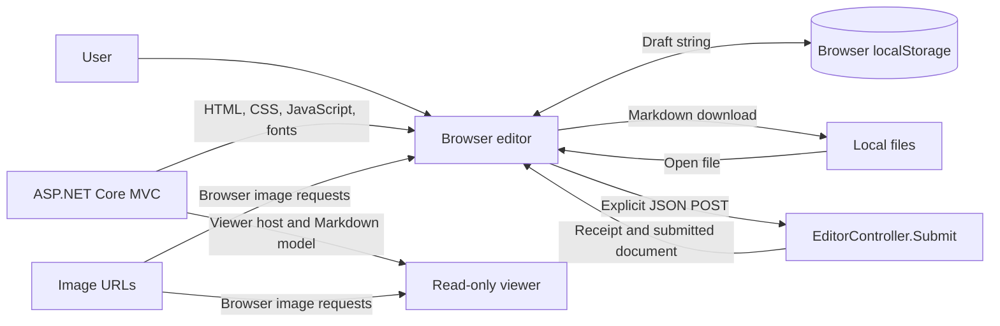
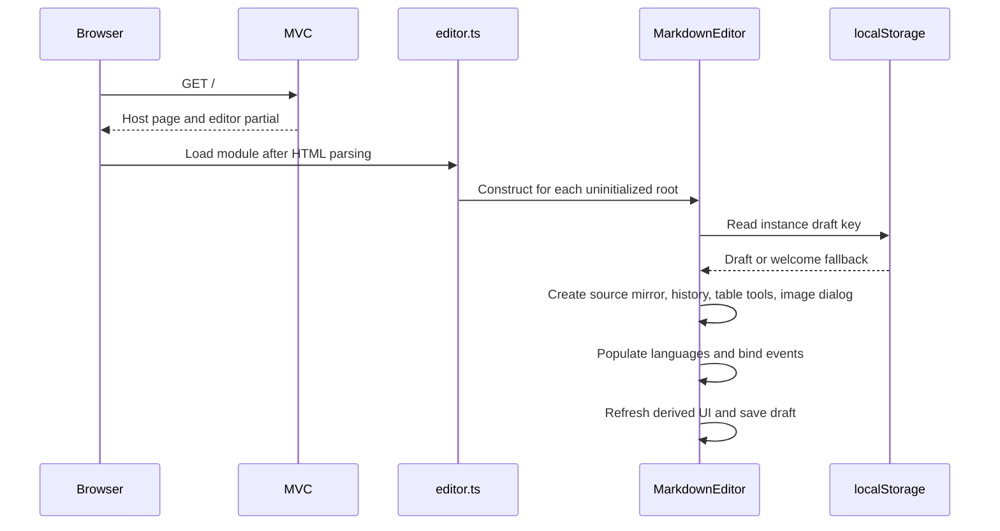
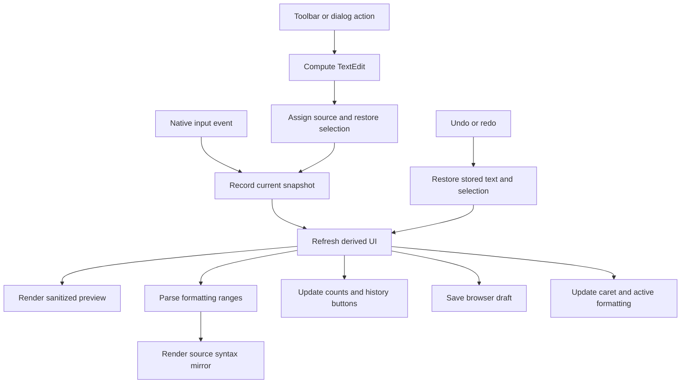
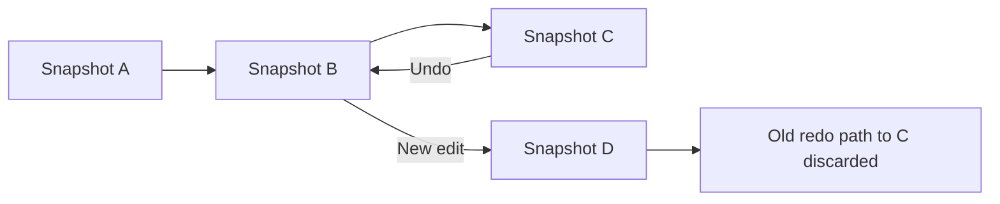
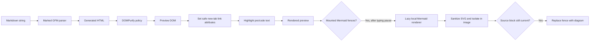
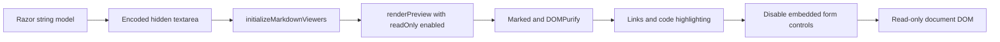
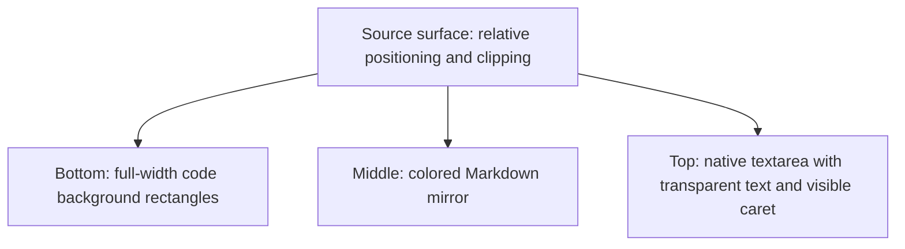
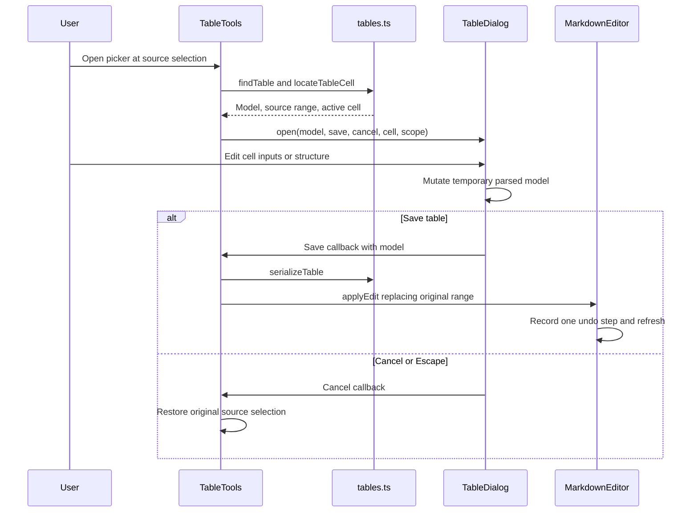
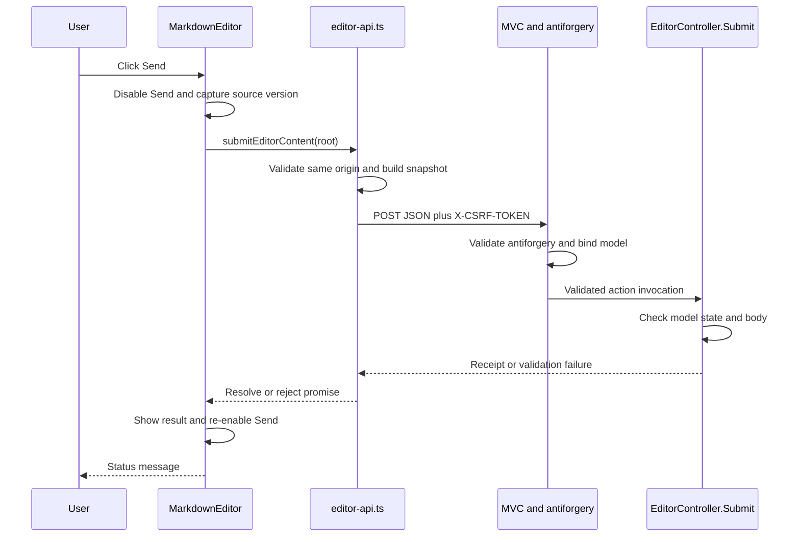
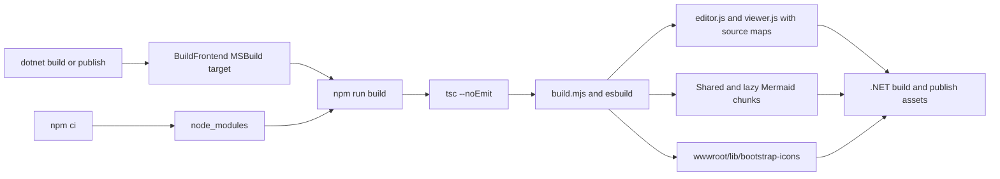

# Markdown Editor: Architecture and Code Guide

This document explains the implemented application, its data flow, and the responsibilities of its source files. It is intended as a guided tour for someone learning the project as well as a reference for future changes.

**Scope:** the current implementation, including source syntax highlighting, Mermaid charts and diagrams, image URL insertion, and the reusable read-only viewer with its Debug sample. Keep this guide and the README aligned with implementation changes as required by [AGENTS.md](../AGENTS.md).

Diagrams use Mermaid syntax. Open this file in a Markdown viewer with Mermaid support to see them rendered. The prose also explains each diagram so the document remains useful in a plain text editor.

## Contents

1. [Purpose and architectural shape](#1-purpose-and-architectural-shape)
2. [Repository and source map](#2-repository-and-source-map)
3. [Server application and request handling](#3-server-application-and-request-handling)
4. [Razor component and DOM contract](#4-razor-component-and-dom-contract)
5. [Browser startup and instance ownership](#5-browser-startup-and-instance-ownership)
6. [Document state and editing lifecycle](#6-document-state-and-editing-lifecycle)
7. [Formatting commands and active styles](#7-formatting-commands-and-active-styles)
8. [Undo and redo](#8-undo-and-redo)
9. [Preview rendering and code highlighting](#9-preview-rendering-and-code-highlighting)
10. [Editable source highlighting](#10-editable-source-highlighting)
11. [Table subsystem](#11-table-subsystem)
12. [Drafts, files, and document representations](#12-drafts-files-and-document-representations)
13. [Submission API and asynchronous behavior](#13-submission-api-and-asynchronous-behavior)
14. [Security and trust boundaries](#14-security-and-trust-boundaries)
15. [Styling, accessibility, and responsive layout](#15-styling-accessibility-and-responsive-layout)
16. [Dependencies and build pipeline](#16-dependencies-and-build-pipeline)
17. [Testing and verification](#17-testing-and-verification)
18. [Performance, lifecycle, and current limitations](#18-performance-lifecycle-and-current-limitations)
19. [Extension and troubleshooting guide](#19-extension-and-troubleshooting-guide)
20. [Suggested reading order and terminology](#20-suggested-reading-order-and-terminology)

## 1. Purpose and architectural shape

Markdown Editor is a toolbar-only Markdown workspace. A native text area holds Markdown source; a neighboring pane displays rendered HTML. Formatting buttons change the source text. Users can manipulate tables in a dialog, insert images by URL and language-tagged code fences, open local files, download Markdown, restore browser drafts, and explicitly submit content to the server. A separate read-only viewer renders a supplied Markdown string without editor controls or browser drafts.

The application is one ASP.NET Core MVC project targeting .NET 10. Its browser behavior is written in strict TypeScript and bundled into separate editor and viewer ES modules. Both use the same rendering implementation. It uses direct DOM APIs rather than a frontend component framework. There is no server-side document domain service, database, repository layer, authentication workflow, or collaborative synchronization implementation in this project.

The main design choice is to treat **Markdown source as the document of record**. Preview HTML, syntax decoration, formatting state, counts, and exported plain text are derived from that source. Editing the preview does not update Markdown; it is a rendering surface, not a second editor.



The browser owns the editing session. Server interaction is needed to load the page and for an explicit submission. Ordinary typing does not POST the draft. The submission action currently echoes an acknowledged document; receiving a success message does not mean it was written to durable server storage.

## 2. Repository and source map

Paths in this document are relative to the repository root unless stated otherwise. Most source links below open the actual implementation.

```text
MarkdownEditor.slnx
AGENTS.md
README.md
Documentation/
  architecture.md
  viewer-sample.md                   Markdown loaded by the Debug viewer
  images/                            Viewer review screenshots
docs/screenshots/                    Existing reference screenshots
MarkdownEditor.Web/
  Program.cs                        Server composition and middleware
  Controllers/EditorController.cs    Editor, viewer, submission, error actions
  Models/MarkdownSubmission.cs       JSON validation contract
  Views/Editor/Index.cshtml          Complete host HTML document
  Views/Editor/Viewer.cshtml         Complete read-only host document
  Views/Shared/_MarkdownEditor.cshtml
  Views/Shared/_MarkdownViewer.cshtml
  Views/_ViewImports.cshtml          Razor imports/tag helper setup
  Scripts/
    editor.ts                       Bundle entry and public API
    viewer.ts                       Reader entry and idempotent initialization
    markdown-editor.ts              One editor instance's coordinator
    dom.ts                          Typed required-element lookup
    editing/                        Source transforms, image dialog, history
    rendering/                      Preview, Mermaid diagrams, source colors, extraction
    persistence/                    localStorage and Axios submission
    tables/                         Table model, operations, and controls
    tests/                          Browser integration tests
    playwright.config.ts            Browser/server test configuration
  wwwroot/css/editor.css            Layout, toolbar, dialogs, preview theme
  wwwroot/css/editor-syntax.css     Source syntax colors and mirror layers
  wwwroot/css/viewer.css            Container sizing and viewer empty state
  wwwroot/images/viewer-sample.svg  Local sample landscape
  wwwroot/js/                       Generated editor/viewer bundles, lazy chunks, maps
  wwwroot/lib/                      Copied Bootstrap Icons files
  package.json / package-lock.json  Frontend scripts and dependencies
  tsconfig.json                     TypeScript compiler policy
  build.mjs                        Bundling and asset copying
  MarkdownEditor.Web.csproj         .NET configuration and frontend hook
  Properties/launchSettings.json   Local development profile
  appsettings.json                 Logging and allowed-host configuration
```

### Browser module responsibilities

| Module | Responsibility | Main output or side effect |
|---|---|---|
| [`editor.ts`](../MarkdownEditor.Web/Scripts/editor.ts) | Finds component roots, initializes each once, exports integration functions | `MarkdownEditor` instances and public functions |
| [`viewer.ts`](../MarkdownEditor.Web/Scripts/viewer.ts) | Renders each server-supplied reader root once | Read-only document DOM; exported `initializeMarkdownViewers` |
| [`markdown-editor.ts`](../MarkdownEditor.Web/Scripts/markdown-editor.ts) | Coordinates controls, events, refreshes, dialogs, file operations, and sending | Changes to source and derived UI |
| [`dom.ts`](../MarkdownEditor.Web/Scripts/dom.ts) | Checks that required elements exist and have the expected DOM type | Typed element or an explicit error |
| [`formatting.ts`](../MarkdownEditor.Web/Scripts/editing/formatting.ts) | Computes source-text transformations | `TextEdit` values |
| [`formatting-state.ts`](../MarkdownEditor.Web/Scripts/editing/formatting-state.ts) | Maps parsed emphasis back to source offsets | `FormattingRange[]` and active styles |
| [`history.ts`](../MarkdownEditor.Web/Scripts/editing/history.ts) | Stores document and selection snapshots | Undo/redo snapshots |
| [`code-blocks.ts`](../MarkdownEditor.Web/Scripts/editing/code-blocks.ts) | Defines language choices and inserts safe backtick fences | Language options and `TextEdit` |
| [`image-dialog.ts`](../MarkdownEditor.Web/Scripts/editing/image-dialog.ts) | Owns image form, URL validation, and saved selection | Escaped image Markdown through an undoable `TextEdit` |
| [`preview.ts`](../MarkdownEditor.Web/Scripts/rendering/preview.ts) | Parses and sanitizes Markdown, decorates links, and optionally disables controls | Editor preview or read-only document DOM |
| [`diagrams.ts`](../MarkdownEditor.Web/Scripts/rendering/diagrams.ts) | Lazily renders mounted Mermaid fences after a typing pause | Isolated SVG images or readable source with errors |
| [`code-highlighting.ts`](../MarkdownEditor.Web/Scripts/rendering/code-highlighting.ts) | Highlights programming languages within preview code blocks | Sanitized highlighting spans |
| [`source-highlighting.ts`](../MarkdownEditor.Web/Scripts/rendering/source-highlighting.ts) | Mirrors source with syntax colors and full-width code backgrounds | Decorative layers beside the native input |
| [`document-content.ts`](../MarkdownEditor.Web/Scripts/rendering/document-content.ts) | Produces Markdown, readable text, and HTML from one snapshot | `MarkdownContent` |
| [`draft.ts`](../MarkdownEditor.Web/Scripts/persistence/draft.ts) | Loads/saves one browser draft key and supplies welcome content | Stored string or fallback |
| [`editor-api.ts`](../MarkdownEditor.Web/Scripts/persistence/editor-api.ts) | Posts document content and translates request errors | `MarkdownReceipt` promise |
| [`tables.ts`](../MarkdownEditor.Web/Scripts/tables/tables.ts) | Creates, locates, parses, serializes, and inserts GFM tables | Table models and source ranges |
| [`table-operations.ts`](../MarkdownEditor.Web/Scripts/tables/table-operations.ts) | Maps caret to cell and changes rows/columns | Mutated temporary table model |
| [`table-tools.ts`](../MarkdownEditor.Web/Scripts/tables/table-tools.ts) | Owns the picker and contextual operations | One committed source edit per operation |
| [`table-dialog.ts`](../MarkdownEditor.Web/Scripts/tables/table-dialog.ts) | Owns the modal cell-editing form and temporary table edits | Save/cancel callbacks |

The coordinator calls focused modules rather than requiring each feature to know about local storage, undo, and preview internals. Table controls and `ImageDialog` receive an `applyEdit` callback as their route into the document update lifecycle.

## 3. Server application and request handling

### Startup

[`Program.cs`](../MarkdownEditor.Web/Program.cs) uses the minimal hosting style to configure an MVC application:

1. Create the web application builder.
2. Register controllers with views.
3. Configure antiforgery to read the request token from `X-CSRF-TOKEN`.
4. Build the application.
5. Outside Development, configure the exception handler at `/Editor/Error` and HSTS.
6. Serve static files, enable routing, and map the conventional MVC route.
7. Run the application.

The route pattern is `{controller=Editor}/{action=Index}/{id?}`. Consequently `/` resolves to `EditorController.Index`, and `/Editor/Submit` resolves to its submission action. Static resources come from `wwwroot` through `UseStaticFiles()`.

HSTS is configured outside Development, but this pipeline does not call `UseHttpsRedirection()`. The launch profile uses HTTP on port 5100. A deployment must supply its intended HTTPS and proxy configuration; it should not infer HTTPS redirection from the presence of HSTS alone.

### Actions

| Action | Request | Behavior |
|---|---|---|
| `Index` | Conventional page request, normally `GET /` | Returns `Views/Editor/Index.cshtml` |
| `Viewer` | `GET /Editor/Viewer?markdown=...` | Returns `Views/Editor/Viewer.cshtml` with the supplied string; loads the sample by default in Debug builds |
| `Submit` | `POST /Editor/Submit` | Validates antiforgery and JSON model, checks model state and null body, returns an acknowledgment |
| `Error` | Error-handler target `/Editor/Error` | Returns a Problem response explaining that the editor could not be loaded |

[`EditorController`](../MarkdownEditor.Web/Controllers/EditorController.cs) has no injected persistence dependency. Its `Submit` method contains the explicit integration point for application-specific storage. The existing action validates shape and lengths; it does not establish that submitted HTML or plain text faithfully represents the submitted Markdown.

### Configuration

The viewer's sample behavior is controlled by the C# `DEBUG` compilation symbol, independently of the ASP.NET Core environment name. With no `markdown` query parameter, a Debug build asynchronously reads `Documentation/viewer-sample.md` from `AppContext.BaseDirectory`, honoring request cancellation. The project copies that file into Debug build/publish output. An explicit `?markdown=` displays an empty document, and supplied text overrides the sample. Release builds exclude sample loading and default to an empty document. The GET endpoint is a short-text host example; application-specific controllers can load documents and pass their Markdown directly as a view model.

[`appsettings.json`](../MarkdownEditor.Web/appsettings.json) sets the default logging level to Information, the ASP.NET Core category to Warning, and `AllowedHosts` to `*`. [`launchSettings.json`](../MarkdownEditor.Web/Properties/launchSettings.json) configures the local Development profile at `http://localhost:5100` and requests browser launch. Neither file contains a database connection string.

## 4. Razor component and DOM contract

[`Index.cshtml`](../MarkdownEditor.Web/Views/Editor/Index.cshtml) is a complete HTML page with `Layout = null`. It includes viewport and description metadata, local Bootstrap Icons CSS, `editor.css`, `editor-syntax.css`, and the generated `editor.js` module. It renders the shared `_MarkdownEditor` partial inside a full-height main element.

[`_MarkdownEditor.cshtml`](../MarkdownEditor.Web/Views/Shared/_MarkdownEditor.cshtml) owns the reusable component markup. It deliberately contains neither script imports nor stylesheet imports; a host page loads those resources once, even if it renders several editors.

At render time, the partial creates a GUID-based editor ID. Labels, dialog references, and `aria-controls` use that prefix to avoid collisions between server-rendered instances. The partial obtains an antiforgery request token with `GetAndStoreTokens(Context)`, which also arranges the corresponding cookie, and places the request token in a hidden input.

### Integration attributes

| Attribute or setting | Meaning |
|---|---|
| `data-markdown-editor` | Root marker used by initialization |
| `data-editor-element` | Stable name for a control within one root |
| `data-command` | Toolbar action identifier, such as `bold`, `undo`, or `send` |
| `data-table-operation` | Contextual table-picker action |
| `data-table-action` | Structural action inside the table dialog |
| `data-storage-key` | Browser storage key for the instance |
| `data-post-url` | Same-origin submission destination |
| `ViewData["MarkdownEditorStorageKey"]` | Server-side override for the storage-key attribute |
| `ViewData["MarkdownEditorPostUrl"]` | Server-side override for the POST destination |

JavaScript generally finds controls by `data-editor-element`, scoped to the editor root. This is separate from CSS presentation classes and generated IDs. Renaming one of those data values requires updating its TypeScript lookup and tests. [`element()`](../MarkdownEditor.Web/Scripts/dom.ts) throws when a required element is missing or has the wrong DOM type, making a broken markup contract visible during initialization.

The component contains a toolbar, source and preview sections, status footer, hidden file input, link and image dialogs, table picker, and table dialog. The `image` toolbar command opens the image dialog using the same visual classes as the link dialog. Table-size buttons, language options, and table-cell inputs are populated by JavaScript.

### Read-only partial contract

[`_MarkdownViewer.cshtml`](../MarkdownEditor.Web/Views/Shared/_MarkdownViewer.cshtml) accepts a string model and contains no resource imports. Its root has `data-markdown-viewer`, `.markdown-viewer`, and `.editor__preview`, with a named, keyboard-focusable region. A hidden textarea marked `data-viewer-source` carries Razor-encoded Markdown until initialization; a `noscript` message explains the JavaScript requirement. The source textarea is replaced by rendered content, so the initialized partial exposes no Markdown source input.

[`Viewer.cshtml`](../MarkdownEditor.Web/Views/Editor/Viewer.cshtml) supplies a full-height host and loads `editor.css`, `viewer.css`, and `viewer.js`. Embedded hosts load those resources once and give their containing element a height. The partial fills that width and height and scrolls internally. It needs neither Bootstrap Icons nor source-highlighting CSS, antiforgery fields, or storage keys.

## 5. Browser startup and instance ownership

[`editor.ts`](../MarkdownEditor.Web/Scripts/editor.ts) executes `initializeMarkdownEditors()` when the module loads. That function searches its supplied container, including the container itself if it is an editor root, and constructs one `MarkdownEditor` for each uninitialized root.

A module-level `WeakSet<HTMLElement>` remembers initialized roots. Calling initialization again does not add duplicate handlers or a second set of table-size buttons to the same element. It tracks root identity; it is not a document-state store.



Each `MarkdownEditor` owns its element references, history object, table controls, image dialog, source highlighting object, filename, link selection, and cached formatting ranges. It does not share those fields with another instance.

For multiple editors, choose distinct storage keys. Their UI state is independent, but two instances using the default `markdown-editor.draft.v1` key write the same browser draft slot. Dynamically inserting a new partial also requires an explicit `initializeMarkdownEditors(newRoot)` call; there is no mutation observer that automatically discovers new roots.

The independent `viewer.ts` entry calls `initializeMarkdownViewers()` on module load. Its own WeakSet prevents duplicate rendering. Initialization reads each root's encoded source textarea and calls `renderPreview(root, markdown, true)`. It creates no editor, history, syntax mirror, draft storage, or submission handlers. Dynamically inserted readers require `initializeMarkdownViewers(container)`; the container itself is included when it is a reader root. Readers and editors can coexist on one page.

## 6. Document state and editing lifecycle

### State model

The text area's `value` is the authoritative document. The application does not maintain a permanent editable syntax tree or use `contenteditable`. Native textarea offsets and JavaScript string offsets are UTF-16 code-unit positions.

| State | Owner | Lifetime |
|---|---|---|
| Markdown string and selection | Native source textarea | Current mounted editor |
| Undo/redo snapshots | `EditorHistory` | Current mounted editor |
| Formatting ranges | `MarkdownEditor.formatting` | Recomputed on each document refresh |
| Preview HTML | Preview DOM | Rebuilt on refresh |
| Source syntax spans/backgrounds | `SourceHighlighting` | Rebuilt/repositioned from source |
| Link insertion selection | `MarkdownEditor.linkSelection` | Until dialog completes or is reopened |
| Image insertion selection and form | `ImageDialog` | Until insertion/cancellation or the next opening |
| Read-only document | Viewer DOM, initially supplied by Razor model | Rendered once per initialized reader root |
| Table edit model | `TableTools` / `TableDialog` | Temporary context for an operation |
| Download filename | `MarkdownEditor.fileName` | Defaults to `untitled.md`; changes on successful file open |
| Draft string | `localStorage` | Across reloads until browser storage changes |
| Submitted JSON | Controller request/response | Current HTTP exchange; no durable server record |

### Typed edits

Formatting helpers return a `TextEdit`: `{ text, start, end }`. `text` is the complete replacement document, while `start` and `end` describe the selection after the operation. The offsets are not a patch to apply to the original string.

`MarkdownEditor.applyEdit()` remembers the old selection, assigns the new string, focuses the textarea, sets the new selection, records history, and refreshes the derived UI. This is how one toolbar or table action becomes one undoable operation.

Typing follows a slightly different entry path: the browser changes `textarea.value`, an `input` event records the resulting snapshot, and the coordinator calls `refresh()`. Undo/redo restores a stored snapshot directly and also refreshes.



The actual refresh order is preview, formatting ranges, source highlighting, counts, draft-save status, undo/redo buttons, and selection state. A selection-only event updates caret position, heading selection, active formatting buttons, and remembered selection without rerendering the entire preview.

Word count is the number of non-whitespace runs, not a linguistic word tokenizer. Character count uses the JavaScript string length, so a visible character represented by a surrogate pair counts as two code units. Caret line/column uses newline boundaries and those same string offsets.

## 7. Formatting commands and active styles

### Command routing

The toolbar uses event delegation. A click is resolved to the closest element with `data-command`, and `runCommand()` dispatches through an action map. The heading and code-language selects have their own change handlers.

[`formatting.ts`](../MarkdownEditor.Web/Scripts/editing/formatting.ts) contains source transformation functions rather than DOM changes:

| Function | Behavior |
|---|---|
| `replaceRange` | Replaces a substring and selects the inserted text |
| `wrapSelection` | Adds or removes matching delimiters; supplies a placeholder for empty selections |
| `transformLines` | Expands selection to touched lines and transforms each line |
| `headingLine` | Removes an existing ATX heading prefix and applies the chosen level |
| `prefixedLine` | Replaces recognized list/task/quote prefixes with the requested prefix |
| `linkMarkdown` | Escapes label brackets/backslashes and encodes parentheses in the URL |

Bold uses `**`, italic uses `*`, strike uses `~~`, and inline code uses backticks. Inline wrapping is a text operation, not a full Markdown syntax rewrite. Line transforms operate on complete touched lines, and a selection ending just after a newline does not unintentionally include the following line.

### Keyboard shortcuts and dialogs

Ctrl on Windows/Linux or Command on macOS is used for B (bold), I (italic), K (link), S (download), Z (undo), Shift+Z (redo), and Y (redo). The handler skips composing input and Alt-modified shortcuts. Browser `beforeinput` events for `historyUndo` and `historyRedo` are routed to the custom history.

Opening the link dialog captures the source selection before focus leaves the editor. The address must start with HTTP or HTTPS, in addition to the native URL-input validation. Save restores the original selection and inserts the computed Markdown; Cancel and Escape restore focus and selection without changing the document.

### Image insertion

The toolbar's `image` command opens [`ImageDialog`](../MarkdownEditor.Web/Scripts/editing/image-dialog.ts). The dialog stores the source selection, suggests the selected text as the image description, clears the URL field, and focuses it. All element lookups and event handlers belong to the current editor root.

The required URL input uses native validation. `imageAddress()` additionally requires an absolute HTTP/HTTPS prefix and parses the address with `new URL()`; malformed addresses and other protocols are rejected with an editable validation message. Submission normalizes description whitespace, defaults an omitted description to `Image`, and builds `` using `linkMarkdown()` for bracket/backslash escaping and URL-parenthesis encoding.

The dialog restores the original selection, then passes `replaceRange()` to the coordinator's `applyEdit` callback. This replaces selected text or inserts at the caret, records one undo step, refreshes the preview, and saves the browser draft. Cancel and Escape restore selection without an edit. Images are referenced by URL; there is no file upload or image proxy. Browser image loading and failures follow the referenced resource's availability.

### Active toolbar state

[`formatting-state.ts`](../MarkdownEditor.Web/Scripts/editing/formatting-state.ts) uses Marked's GFM lexer to identify `strong`, `em`, and `del` tokens. It recursively visits nested token lists and table cells, while code and literal HTML are left out of emphasis interpretation.

The parser can remove list or quote prefixes when exposing child text. `mapFragment()` therefore tracks a mapping from a child's characters to the original source positions. It first attempts an exact substring match; when that is unavailable, it maps characters forward through the parent fragment. `addRange()` records the content inside the delimiters.

`activeFormatting()` considers a style active when the caret, or the whole selected range, lies within one of its content ranges. More than one style can be active for nested emphasis. The coordinator reflects the result through `aria-pressed` and `toolbar__button--active`. Cached ranges are reused while the user only moves the selection.

### Fenced-code insertion

[`code-blocks.ts`](../MarkdownEditor.Web/Scripts/editing/code-blocks.ts) defines 30 language/format choices, including Mermaid charts and diagrams, plain text, C#, TypeScript, SQL, Python, Rust, and Markdown. Inserting a code block wraps selected text or the `code here` placeholder, supplies paragraph spacing, and selects the block body for typing.

The opening fence uses at least three backticks and is longer than any backtick run in the body. This prevents selected content containing triple backticks from prematurely closing the newly inserted fence. Choosing a language resets the dropdown so the same choice can be selected again.

## 8. Undo and redo

[`EditorHistory`](../MarkdownEditor.Web/Scripts/editing/history.ts) stores complete `TextEdit` snapshots in an array and maintains the index of the current entry. It keeps at most 200 snapshots.

Recording unchanged text does not add an undo step. Recording a change after undo discards all redo entries beyond the current index. When the cap is exceeded, the oldest snapshot is removed. `move()` clamps its index so it cannot leave the array bounds; `canMove()` drives disabled toolbar states.

`rememberSelection()` updates the current snapshot's selection only if the snapshot text still matches. This lets undo restore useful caret positions without treating every click or arrow key as an edit.



History is held in memory, separately from the local draft. Reloading restores the draft text but starts a new history. Typed input is recorded per input event; there is no custom time-based grouping into words or sentences. Filename changes are also outside document snapshots, so undoing an opened file's content does not undo the selected download filename.

## 9. Preview rendering and code highlighting

[`renderPreview()`](../MarkdownEditor.Web/Scripts/rendering/preview.ts) parses the source synchronously with `marked.parse`, using GFM and `breaks: false`. GFM supplies features such as tables, task lists, and strikethrough. An ordinary newline in prose is not configured to become an automatic hard line break.

The generated HTML is passed through DOMPurify before insertion into the preview. The configuration enables the HTML profile, forbids `style`, `form`, and `iframe` elements, forbids `style` and `contenteditable` attributes, and enables named-property sanitization. Allowed links are then given `target="_blank"` and `rel="noopener noreferrer"`.



[`code-highlighting.ts`](../MarkdownEditor.Web/Scripts/rendering/code-highlighting.ts) loads Highlight.js's common language set plus explicit registrations for PowerShell, Dart, and Dockerfile. It reads each `pre code` element's text content and its `language-*` class.

If a known language is declared, it highlights with that language and `ignoreIllegals: true`. With no language, it uses automatic detection. Unknown declared languages and explicit no-highlight classes leave text intact. Generated highlighting HTML is sanitized again with only `span` tags and `class` attributes allowed, and the code element receives `hljs`.

The source-code theme and preview-code theme are independent. The preview currently uses a dark code-block background with language-token colors in `editor.css`. This does not imply that source code inside Markdown fences receives the same programming-language token colors.

The empty-preview class is toggled using whether the Markdown trims to an empty string. The visible empty message is supplied by CSS rather than inserting document content.

### Mermaid charts and diagrams

After synchronous Markdown sanitization and highlighting, `renderPreview` schedules Mermaid rendering only for mounted DOM containers. [`diagrams.ts`](../MarkdownEditor.Web/Scripts/rendering/diagrams.ts) finds `pre > code.language-mermaid`, debounces each preview for 150 milliseconds, and lazily imports the locally bundled Mermaid library. Initialization disables automatic scanning, uses strict security and SVG text labels, and caps definitions at 50,000 characters and 500 edges. Mermaid supports the flowcharts and sequence diagrams used throughout this document as well as chart types such as pie charts. The code-block dropdown also offers Mermaid fences.

Each block renders asynchronously in a temporary layout container that is removed in `finally`. Before and after rendering, the module checks that the original code block still belongs to the preview; stale work cannot replace newer content. Multiple instances share the lazy renderer while owning separate debounce timers and blocks. A malformed definition retains its source with a status message; valid neighbors still render. Library load failures also retain source and allow a later refresh to retry.

Mermaid output passes through a separate SVG DOMPurify policy that removes scripts, foreign HTML, links, and embedded images. The sanitized SVG is encoded into an image data URL, which isolates its markup from the host document. Application-owned security, HTML-label, and theme configuration cannot be relaxed through diagram directives. No diagram interaction callbacks are bound. Images have alternative text and scale within their pane; authors should include prose descriptions for complex diagrams. Rendering uses local assets and does not send diagram source to a remote service.

`getEditorContent` intentionally renders into a detached element, so its synchronous Markdown/plain-text/HTML snapshot preserves diagram definitions as fenced code. Export and submission do not wait for the asynchronous image rendering or include generated SVG images. Drafts and Markdown downloads retain the original source.

### Reader rendering and images

The optional `readOnly` argument defaults to `false`. The viewer passes `true`, which additionally disables rendered `input`, `button`, `select`, and `textarea` controls. Task-list checkboxes remain visible but disabled. Links retain normal navigation behavior. The viewer's empty message is “No Markdown content to display.”



Markdown image syntax produces sanitized `img` elements in both the editor preview and reader; image display uses the same rendering path. `.editor__preview img` constrains width to the container and preserves aspect ratio with `height: auto`. Relative URLs resolve against the host page, while absolute URLs load from their specified origin. The Debug sample references the local [`viewer-sample.svg`](../MarkdownEditor.Web/wwwroot/images/viewer-sample.svg), so it can demonstrate image display without a third-party service.

## 10. Editable source highlighting

### Why there are multiple layers

A textarea cannot color separate ranges within its value. [`SourceHighlighting`](../MarkdownEditor.Web/Scripts/rendering/source-highlighting.ts) therefore wraps the existing textarea in a positioned source surface and puts decorative layers behind it. The original textarea remains the focusable, selectable input.



The textarea's text is transparent in normal color mode, allowing the colored mirror beneath it to show through. Its caret stays visible. Pointer events pass through decorative layers. The mirror and code-background container have `aria-hidden="true"` so assistive technology encounters the real input rather than duplicate document text.

### Rendering and synchronization

On a document refresh, Highlight.js's Markdown grammar produces escaped source text wrapped in syntax spans. DOMPurify sanitizes that result before it is assigned to the mirror. The source characters, including Markdown markers, remain visible.

GFM strike ranges from `formattingRanges()` are applied separately. A text-node walker maps each node's text to document offsets and wraps intersecting strike content in `editor__syntax--strike` spans using DOM text properties. This supplies strikethrough decoration without evaluating the source as HTML. A final newline is appended to the mirror to preserve the blank line needed for a trailing caret.

The `sync()` method matches the input's client width, client height, computed padding, font size, and scroll offsets. A scroll handler and a `ResizeObserver` repeat that work as the input scrolls or changes size. Both layers use matching font family, line height, tab size, letter spacing, and wrapping rules in CSS.

Matching geometry is a correctness requirement: if the mirror wraps a line differently from the textarea, the visible text no longer matches the native caret or selection. Typography changes must be checked in both layers, at narrow widths as well as desktop widths.

### Continuous code backgrounds

`paintCodeBlocks()` examines `.hljs-code` spans whose text begins with a backtick or tilde fence, allowing up to three leading spaces. It measures their inline client rectangles, uses the first and last visual line and the textarea's line height to calculate the full block height, and places a background rectangle across the source surface.

The rectangle covers the opening fence, code body, intervening blank lines, and closing fence. It is independent of text layout, so it does not add padding or change selection offsets. Its position is recomputed after scrolling and resizing. Fenced spans have a transparent inline background; ordinary inline code retains a compact background behind its text.

Source colors live in [`editor-syntax.css`](../MarkdownEditor.Web/wwwroot/css/editor-syntax.css). Variables include `--syntax-text`, `--syntax-surface`, `--syntax-heading`, `--syntax-bold`, `--syntax-italic`, `--syntax-strikethrough`, `--syntax-link`, `--syntax-code`, `--syntax-code-background`, `--syntax-quote`, and `--syntax-marker`.

There are two parsers involved in source-related behavior: Highlight.js's Markdown grammar supplies visual syntax spans, while Marked supplies semantic formatting ranges and the preview. Their edge-case interpretations are not guaranteed to be identical. The decoration is derived presentation, not the authority on document meaning.

## 11. Table subsystem

### Models and source ranges

[`tables.ts`](../MarkdownEditor.Web/Scripts/tables/tables.ts) defines:

| Type | Fields | Meaning |
|---|---|---|
| `MarkdownTable` | `cells: string[][]`, `alignments: TableAlignment[]` | Header/body cell source and alignment per column |
| `TableAlignment` | `left`, `center`, `right`, or `null` | GFM delimiter-row alignment |
| `LocatedTable` | `table`, `start`, `end` | Parsed table plus replacement boundaries in the document |
| `TableCellPosition` | `row`, `column` | Zero-based logical cell location |
| `TableScope` | `table`, `column`, `row`, or `cell` | Visual selection scope in the dialog |

The first row in `cells` is the header. The Markdown alignment delimiter row is generated during serialization and is not stored as a row of editable cells. A requested row count includes the header.

`findTable()` walks Marked's top-level tokens, accumulates their raw lengths, and returns the table containing the full source selection. It trims trailing whitespace from the replacement boundary so adjacent prose and tables are preserved. It does not descend into nested containers; editing a table inside a blockquote or list is outside this lookup's current scope.

Cell text remains Markdown source. It is not converted to rendered HTML for editing. Serialization emits a header, alignment delimiter row, and body rows, escapes literal pipes, and flattens cell line breaks to spaces. It normalizes table formatting rather than preserving the exact original pipe spacing.

### Picker and contextual operations

[`TableTools`](../MarkdownEditor.Web/Scripts/tables/table-tools.ts) builds a five-by-five grid of size buttons. Pointer hover and keyboard focus update the highlighted rectangle. Arrow keys move through the grid; clicking a size inserts a table immediately. The separate Insert button uses the current dimensions.

Opening the picker captures the source selection before moving focus. It locates a table at that selection and enables editing only when one is found. New table insertion occurs at the saved start position without consuming selected document content.

Contextual commands insert columns left/right, insert rows above/below, delete rows/columns/the table, or open a scoped cell editor. `locateTableCell()` maps the caret to a logical row and column. It counts unescaped pipe separators, accounts for a leading pipe, treats the alignment delimiter as the header, and clamps positions to the model bounds.

The row/column helpers in [`table-operations.ts`](../MarkdownEditor.Web/Scripts/tables/table-operations.ts) mutate the temporary model. Removing the final row or column reports that no valid table remains; contextual operations then replace the table's source range with an empty string. Deleting a header promotes the next row to header. Alignments stay with their columns.

### Dialog transaction

[`TableDialog`](../MarkdownEditor.Web/Scripts/tables/table-dialog.ts) is a modal editor for a parsed table model. Each cell is an input with a row/column data attribute and an accessible label. Header cells use `th`, body cells use `td`, and the requested scope is visually highlighted.



The temporary model is already separate from the source string, so changing inputs does not alter the document until Save. The dialog prevents deleting its last row or column; removing the entire table is instead a contextual picker operation. Cancel and Escape close without committing to Markdown. Structural changes rerender the grid, which is why active-cell tracking and selection highlighting are separate methods.

## 12. Drafts, files, and document representations

### Browser drafts

[`draft.ts`](../MarkdownEditor.Web/Scripts/persistence/draft.ts) reads and writes a string in `localStorage`. A missing value uses the built-in welcome Markdown. An intentionally saved empty string is preserved because the loader uses nullish fallback rather than truthiness.

Storage exceptions are caught. Loading falls back to welcome content; saving returns `false`, which the coordinator turns into a footer message recommending download. Draft writes are synchronous and occur on refresh, including initial refresh and history navigation. Only Markdown is saved: filename, history, caret, dialog state, and receipts are not persisted.

There is no cross-tab conflict resolution or `storage` event handler. Tabs sharing an origin and storage key can overwrite the same draft. Browser storage is a convenience, not a durable server backup.

### Local file import/export

The hidden input accepts `.md`, `.markdown`, `.txt`, plain text, and Markdown MIME types as file-picker hints. `openFile()` rejects files larger than 1,048,576 bytes before reading with `File.text()`. If the existing source is nonempty, replacement requires a confirmation dialog. The loaded text normalizes CRLF and CR line endings to LF and is applied as one undoable edit with the caret at the start.

The filename is converted to a `.md` filename for later download. File content is read locally; this flow does not upload the file. Read failures leave an error message. The input value is cleared so the same file can be chosen again.

Download creates a UTF-8 Markdown `Blob`, obtains a temporary object URL, clicks a download anchor, and revokes the URL after one second. It uses the original source string, not the rendered preview. A download does not mark or clear the draft.

### Three synchronized representations

[`getEditorContent(root)`](../MarkdownEditor.Web/Scripts/rendering/document-content.ts) captures the current Markdown, renders it through the same sanitized preview pipeline into a detached element, and returns:

```json
{
  "markdown": "**Hello**",
  "plainText": "Hello",
  "html": "<p><strong>Hello</strong></p>\n"
}
```

This ensures all fields are produced from the same source snapshot rather than reading potentially stale visible HTML. The returned HTML includes preview code-highlighting spans and link attributes. It is a fragment without the preview container's CSS or a complete HTML document.

Plain-text extraction traverses the sanitized DOM. It keeps paragraph separation, turns `<br>` into newlines, preserves `<pre>` text whitespace, uses image alt text, and separates table columns with tabs and rows with newlines. It is readable text extraction rather than a lossless reverse conversion or a complete Markdown-to-text specification; for example, semantic list or checkbox markers are not reconstructed as source syntax.

## 13. Submission API and asynchronous behavior

### Contract and validation

[`MarkdownContent`](../MarkdownEditor.Web/Scripts/rendering/document-content.ts) and the C# [`MarkdownSubmission`](../MarkdownEditor.Web/Models/MarkdownSubmission.cs) model correspond to the three fields above. JavaScript uses camelCase JSON; ASP.NET Core's configured-by-default JSON model binding accepts those names for the PascalCase C# properties.

| Constraint | Value | Unit and enforcement |
|---|---|---|
| Markdown length | 1,048,576 | .NET string length, model validation |
| Plain-text length | 1,048,576 | .NET string length, model validation |
| HTML length | 4,194,304 | .NET string length, model validation |
| Request body | 8,388,608 | Bytes, action `RequestSizeLimit` |
| File import | At most 1,048,576 | Bytes, browser file-size check |
| HTTP client timeout | 15,000 | Milliseconds, Axios instance |

All three fields are required but permit empty strings. Missing or invalid fields produce validation errors; a null document is rejected. String-length limits and request-byte limits are separate constraints, particularly with non-ASCII text or JSON escaping. Typing itself has no corresponding textarea length cap.

The success response is `{ "message": "Document received.", "document": { ... } }`. `MarkdownReceipt` describes that shape for TypeScript, but there is no runtime schema validator for the response.

### Request lifecycle

[`submitEditorContent()`](../MarkdownEditor.Web/Scripts/persistence/editor-api.ts) reads `data-post-url`, rejects a missing or cross-origin endpoint, reads the hidden request token, creates a fresh document snapshot, and posts JSON with `X-CSRF-TOKEN`. Axios has a 15-second timeout and a JSON content-type header.



The toolbar path disables Send and sets `aria-busy` until completion. Editing remains possible while sending. When a receipt arrives, the coordinator compares the current Markdown with the captured sent version. It distinguishes “Document sent” from “Previous version sent; current edits remain local.” It never replaces the editor with an echoed server document.

After success, it dispatches a bubbling `markdown-editor:submitted` event on that editor root, with the receipt as `event.detail`. Host pages can observe this to update their own UI.

Request failures become footer messages for timeout, unreachable server, bad request, oversized request, or generic failure. There is no automatic retry. A document refresh also writes draft status into the same footer, so typing can replace a previously displayed request message.

### Host API

The bundle exports `initializeMarkdownEditors`, `getEditorContent`, and `submitEditorContent`, plus TypeScript content/receipt types. A host can call the functions for a specific root or configure an alternate same-origin action through the partial's ViewData setting.

The exported submission helper performs the HTTP operation only. The toolbar's duplicate-click guard, busy button, status messages, and submitted-event dispatch belong to `MarkdownEditor.submit()`; callers using the helper directly must manage their own user-facing lifecycle.

## 14. Security and trust boundaries

The important boundary is untrusted Markdown or submitted JSON crossing into HTML or application storage.

| Boundary | Current control | Meaning and limit |
|---|---|---|
| Markdown to preview DOM | DOMPurify after Marked | Parser output is sanitized before DOM insertion |
| Code text to preview spans | Text extraction, Highlight.js, span-only sanitization | Code is interpreted for colors, not executed |
| Mermaid source to diagram image | Strict Mermaid settings, locked security configuration, SVG sanitization, image isolation | Diagrams cannot execute host scripts or bind click actions; oversized/invalid definitions retain source |
| Source text to syntax mirror | Highlight.js escaping and DOMPurify; strike uses text nodes | Source markup remains text in the mirror |
| Link dialog to Markdown | HTTP/HTTPS validation and escaping | Dialog rejects executable protocols; direct source still goes through preview sanitization |
| Image dialog to Markdown | Absolute HTTP/HTTPS validation, URL parsing, label escaping | Dialog limits inserted addresses; the browser fetches the image directly |
| Razor model to reader | Razor encoding, then the shared sanitized renderer | Model text cannot break out of the hidden source textarea as executable HTML |
| HTML controls to reader | Removes `contenteditable`; disables embedded form controls | Reader has no editing workflow; links and image requests remain active |
| Preview links to new tabs | `noopener noreferrer` | New tabs do not receive an opener reference from these links |
| Browser to POST endpoint | Same-origin check plus antiforgery token | Restricts intended submission destination and checks request authenticity |
| JSON to controller model | Required fields, string limits, body limit | Validates request structure/size; does not sanitize HTML server-side |
| Draft string to local storage | Browser-origin storage isolation | Draft remains accessible to scripts on the same origin |

The example server must continue treating all client fields as untrusted. A caller can bypass the browser and send arbitrary HTML or mismatched representations. If durable storage or later HTML rendering is added, decide whether to regenerate HTML from authoritative Markdown on the server or sanitize it there under an explicit policy.

Antiforgery does not provide authentication, authorization, or per-user document ownership. Those concerns must be designed if this editor becomes part of a multi-user application. The current code does not implement them.

Draft content is not automatically transmitted to the application's server while typing. However, allowed Markdown images can reference external addresses and cause the browser to fetch them in either preview or reader; links can navigate externally when clicked. Viewer query text is sent to the server as part of the GET URL. Private or larger documents should be supplied through an application-specific controller/model rather than the example query-string host. This is not a network-isolated editor or an offline-installed application. There is no service worker in the repository.

## 15. Styling, accessibility, and responsive layout

[`editor.css`](../MarkdownEditor.Web/wwwroot/css/editor.css) scopes most component presentation under `.editor`. It uses BEM-style names for blocks, elements, and modifiers, including `toolbar__button--active` and `editor__pane--preview`.

The editor is a vertical flex container: toolbar at the top, flexible panes in the middle, and a status footer at the bottom. The pane region uses two equal-width grid columns with `minmax(0, 1fr)`, permitting content to shrink without forcing the whole page wider. Preview images are constrained to container width; preview tables and code blocks can scroll horizontally.

At widths up to 900px, toolbar gaps/padding tighten, text labels and hints reduce, and pane padding shrinks. At widths up to 560px, the panes stack vertically with minimum row heights, the preview border moves to the top, and status content is simplified. The table picker uses a fixed position on narrow layouts; dialogs and their internal grids have constrained sizes and scrolling.

The preview defines its own `--preview-*` tokens, while source syntax defines `--syntax-*` tokens in `editor-syntax.css`. Keep those responsibilities separate when changing a theme. The component declares a light color scheme; there is no theme-toggle state machine.

Accessible behavior includes labels for source/preview controls and dialogs, icon buttons with accessible names, a toolbar role, `aria-pressed` for emphasis, `aria-expanded` for picker/menu state, footer status announcements, labeled cell inputs, and native modal dialogs. Focus and source selection are restored when link, image, and table dialogs are dismissed. The image dialog accepts an alternative-text description. The picker can be operated with the keyboard.

The reader reuses `.editor__preview` typography and image styles outside an `.editor` root. [`viewer.css`](../MarkdownEditor.Web/wwwroot/css/viewer.css) adds full-container sizing, a focus outline, light color scheme, accent token, and a reader-specific empty message. It supplies no toolbar or source pane; container scrolling handles long documents at desktop and phone widths.

In forced-color mode, CSS hides the source mirror and restores system text and caret colors to the native textarea. Decorative backgrounds remain a presentation concern rather than document content. These features are implementation details and automated checks, not a claim of a completed accessibility certification.

## 16. Dependencies and build pipeline

### Runtime and development libraries

| Dependency | Used for |
|---|---|
| ASP.NET Core MVC / .NET 10 | HTTP hosting, Razor views, controller routing, antiforgery, model validation |
| Marked | Markdown HTML parsing, semantic emphasis ranges, and table discovery |
| DOMPurify | Browser HTML sanitization at preview/highlighting boundaries |
| Highlight.js | Programming-language highlighting in preview and Markdown source decoration |
| Mermaid | Local, lazy rendering of charts and diagrams from Mermaid fences |
| Axios | JSON submission, timeout, and error identification |
| Bootstrap Icons | Local icon font and CSS; the Bootstrap UI framework is not used |
| TypeScript | Static checking for application and test source |
| esbuild | Bundling, minification, and source maps |
| Playwright | Real-browser integration tests |
| Node type definitions | Types used by build/test configuration |

[`package.json`](../MarkdownEditor.Web/package.json) declares allowed dependency ranges; `package-lock.json` records the reproducible resolved dependency graph. `npm ci` installs from that lockfile. The README specifies Node.js 22 or newer and an SDK capable of targeting .NET 10.

### Compilation and asset generation



[`tsconfig.json`](../MarkdownEditor.Web/tsconfig.json) targets ES2022, uses ESNext modules with bundler resolution, includes DOM libraries, and enables strict checking plus unused-local and unused-parameter checks. It includes all TypeScript beneath `Scripts`, including tests. TypeScript checking itself emits nothing.

[`build.mjs`](../MarkdownEditor.Web/build.mjs) bundles `Scripts/editor.ts` and `Scripts/viewer.ts` into separate minified ES modules in `wwwroot/js`, with source maps, and copies the Bootstrap Icons CSS, font files, and license into `wwwroot/lib`. esbuild code splitting shares rendering dependencies across entry points and emits dynamically imported Mermaid and diagram-type chunks into `wwwroot/js/chunks`. Deploy that directory with the entry bundles; importing only `editor.js` or `viewer.js` without their chunks is insufficient. It does not compile or bundle CSS. Host views reference the CSS files directly.

[`MarkdownEditor.Web.csproj`](../MarkdownEditor.Web/MarkdownEditor.Web.csproj) runs the frontend build before ordinary .NET builds, except design-time builds. It selects `npm.cmd` on Windows and `npm` elsewhere. It then refreshes generated static content items for publishing. This matters because generated assets may not exist when MSBuild first evaluates the project.

Its Debug-only content item links `Documentation/viewer-sample.md` from the repository into the output and publish directory, preserving newer copies. Release output does not include this content item. The local SVG under `wwwroot/images` is an ordinary static asset available in both configurations.

The .NET target does not install npm dependencies. Restore them before building. There is also no frontend watch server; changes to TypeScript require rebuilding the bundle. `node_modules`, generated bundle files, and generated third-party assets are not source files to edit by hand.

### Local commands

Run the npm/npx commands from `MarkdownEditor.Web`:

```powershell
npm.cmd ci
npm.cmd run build
npx.cmd playwright install chromium
npm.cmd test
```

Run these .NET commands from the repository root:

```powershell
dotnet build MarkdownEditor.slnx
dotnet run --project MarkdownEditor.Web
dotnet publish MarkdownEditor.Web -c Release
```

On macOS/Linux, use `npm` and `npx` without `.cmd`. Publishing generates application artifacts; the repository does not define a hosting provider, infrastructure configuration, or deployment pipeline.

## 17. Testing and verification

[`Scripts/playwright.config.ts`](../MarkdownEditor.Web/Scripts/playwright.config.ts) points Playwright at `Scripts/tests`, uses Chromium, and sets a default 1440-by-960 viewport. Tests are fully parallel. The configuration starts the MVC app on `http://localhost:5100` with `dotnet run --no-launch-profile --urls ...`, waits up to 120 seconds, and reuses an existing server outside CI.

Reusing a server speeds local runs, but it also means the developer must ensure that a running server serves the intended current build. The configured output directory is the web project's `test-results`; screenshots are captured on failure, and selected tests explicitly save layout screenshots.

The default test server builds Debug. Viewer sample-loading tests require that configuration, including when reusing a server. Release compilation separately verifies that the Debug-only controller path is excluded.

| Suite | Main behavior protected |
|---|---|
| `editor.spec.ts` | Live rendering, draft restoration, formatting, history, headings/lists, links, HTML safety, files, layout |
| `code-blocks.spec.ts` | Language choices, safe code fences, placeholder selection, undo, phone controls |
| `diagrams.spec.ts` | Mermaid flowcharts, sequences, charts, live edits, drafts, synchronous exports, invalid/oversized definitions, stale rendering, security settings, multiple instances, desktop/phone sizing |
| `formatting-state.spec.ts` | Nested emphasis, source selection, ignored literal syntax, toolbar state |
| `highlighting.spec.ts` | Programming-language code preview, unknown languages, literal HTML code, long lines |
| `images.spec.ts` | Image URL insertion, loaded image/alt text, URL escaping and validation, caret/selection, undo/redo, drafts, cancellation, independent instances, desktop/phone sizing |
| `source-highlighting.spec.ts` | Source colors, strike decoration, exact mirrored text, full-width fences, desktop/phone geometry |
| `partial.spec.ts` | Host resources, labels, multiple independent editors, repeated initialization |
| `submission.spec.ts` | JSON payload, antiforgery, validation, empty documents, failures, duplicates, edits during send, content extraction |
| `tables.spec.ts` | Table insertion, editing/canceling, contextual operations, escaped pipes, alignments, adjacent content, phones |
| `viewer.spec.ts` | Read-only formatting, sanitization, Debug sample, empty-query override, independent embedded readers, loaded images, desktop/phone sizing and scrolling |

There is no numeric coverage requirement and no separate C# unit-test project in this repository. Server behavior is exercised through browser and HTTP interactions in Playwright. These tests establish behavior in the configured Chromium environment; they do not establish browser-matrix compatibility or large-document performance limits.

Use the current test run as validation evidence rather than treating a fixed test count in this guide as a lasting guarantee. Documentation-only changes require checking descriptions, commands, diagrams, and local links against the implementation; they do not require another full browser run when runtime behavior is unchanged.

## 18. Performance, lifecycle, and current limitations

### Work performed per edit

Every document refresh reparses the whole Markdown preview, sanitizes and replaces preview HTML, highlights preview code blocks, lexes formatting ranges, rebuilds source syntax spans, updates statistics, and synchronously saves the draft. The formatting mapper allocates a position mapping across the source's UTF-16 length. Undo snapshots also retain whole document strings.

Mounted Mermaid fences render asynchronously after a 150-millisecond pause, loading the renderer only when needed. Obsolete blocks are ignored, but a Mermaid render already in progress is not cancellable. Large numbers of diagrams still require browser layout work; the per-definition character/edge limits do not constitute a document-wide CPU budget.

This approach keeps behavior easy to reason about for ordinary documents. It does not use incremental parsing, virtualized rendering, a worker thread, debounced persistence, or an incremental undo patch model. No measured maximum responsive document size is established. A 1 MiB file-import guard is an input constraint, not a latency guarantee.

Source highlighting also measures DOM geometry after styling changes and rebuilds fence rectangles during synchronization. Scroll events can therefore involve layout reads and DOM writes. If larger documents become a requirement, measure editing and scrolling latency before choosing optimizations such as scheduling decoration work or caching fence measurements.

### Lifecycle boundaries

The code initializes instances once but does not expose a destroy/dispose API. `TableTools` adds a document-level outside-click listener, and `SourceHighlighting` creates a resize observer without an explicit disconnect path. A future host that frequently removes/replaces editor components should add lifecycle cleanup before assuming repeated mounting is resource-neutral. The WeakSet prevents duplicate initialization; it does not by itself unregister listeners or observers.

### Current product limits

- One draft string per configured key; no document list, versioned server history, or multi-user collaboration.
- No durable server persistence, authentication, authorization, retry queue, or conflict resolution.
- Images are URL references with no upload, proxy, cache, or custom load-error UI.
- Mermaid diagrams are static images without click actions, pan/zoom controls, or HTML labels. Invalid definitions retain source; synchronous HTML export retains fences rather than rendered SVG.
- No cross-tab draft reconciliation and no persistence of undo, filename, or selection across reloads.
- Table editing locates top-level tables and serializes them to normalized source; it is not a lossless Markdown formatter.
- Source syntax colors and semantic parsing can differ for unusual Markdown. Continuous fence backgrounds depend on code spans identified by the highlighting grammar and the fence-prefix check.
- Plain-text output is a readable derived representation rather than a lossless equivalent of the source.
- No automatic discovery of dynamically inserted editors or readers and no built-in component disposal. A reader renders its supplied model once; changing an existing reader has no dedicated update API.
- No service worker, offline application packaging, or production deployment configuration.

These are boundaries of the current implementation, not features promised by the architecture.

## 19. Extension and troubleshooting guide

### Where to make a change

| Desired change | Start here | Preserve |
|---|---|---|
| Add a toolbar action | Partial markup, `MarkdownEditor.runCommand`, focused editing helper | `TextEdit` and centralized history/refresh path |
| Change source colors | `wwwroot/css/editor-syntax.css` | Mirror/input geometry and forced-color fallback |
| Change preview appearance | `editor.css` preview selectors/tokens | Scoping and overflow containment |
| Add a fence language | `code-blocks.ts` and Highlight.js registration in `code-highlighting.ts` | Dropdown tag matches a registered language or alias |
| Add table operations | `table-operations.ts`, `table-tools.ts`, dialog/partial if needed | Rectangular model, alignments, correct replacement boundaries |
| Save documents on server | `EditorController.Submit` and a new application persistence service | Server trust checks, authorization, validation, durable success semantics |
| Embed several editors | Host view and partial ViewData | Unique storage keys, resources loaded once, root-scoped lookups |
| Embed read-only documents | `_MarkdownViewer.cshtml`, `viewer.ts`, host resources | String model, container height, explicit initialization after dynamic insertion |
| Change image insertion | `image-dialog.ts` and image form markup | HTTP/HTTPS validation, escaped Markdown, selection restoration, one undoable edit |
| Export another format | `document-content.ts` or a separate exporter | Snapshot consistency and safe HTML boundaries |
| Support frequent dynamic mounting | `editor.ts` and component classes | Explicit event/observer cleanup |

These are suggested extension locations based on current responsibility boundaries, not new layers already present in the project. A server persistence service, for example, would be new code.

### Common symptoms

| Symptom | Checks |
|---|---|
| TypeScript edits do not appear | Rebuild frontend; confirm host loads the generated bundle; check for an old reused server |
| Editor initialization throws a missing-element error | Compare partial data attributes and element types with `element()` lookups |
| Two editors restore the same text | Set different `MarkdownEditorStorageKey` values |
| Reader shows no formatted content | Load `viewer.js` and both reader stylesheets; initialize dynamically added roots; give the container a height |
| Viewer unexpectedly shows the sample | Debug builds load the sample when the `markdown` parameter is absent; supply text or use `?markdown=` for an empty document |
| Inserted image does not load | Check the URL points to an accessible image and the browser network result; both reader and preview fetch the resource directly |
| Draft disappears after browser storage is blocked/cleared | Check the footer; use download; localStorage is the only automatic draft store |
| Source caret and colored text disagree | Compare widths, padding, fonts, line heights, wrapping, and scroll positions of input/mirror |
| Code background covers only inline text | Check fence recognition, `.editor__syntax--fenced`, backing rectangles, and loaded syntax CSS |
| Programming language is uncolored | Check the fence tag, Highlight.js registration, and explicit no-highlight classes |
| Existing table cannot be edited | Put the complete source selection within a top-level GFM table, outside a code fence |
| POST returns 400 | Check request token/header/cookie, required JSON fields, and string validation limits |
| POST returns 413 | Check body-byte limits in the action and any deployment proxy |
| Send succeeds but there is no saved server record | The example action acknowledges only; durable storage has not been implemented |

For changes, follow [AGENTS.md](../AGENTS.md): keep functions focused, document TypeScript functions/callbacks, sanitize HTML before insertion, maintain the toolbar-only UI, and update both [README.md](../README.md) and this architecture guide when features, configuration, dependencies, commands, or project structure change.

## 20. Suggested reading order and terminology

To follow the code without reading every file at once:

1. Read `Program.cs`, `EditorController.cs`, and `Index.cshtml` to see what the server sends.
2. Read `_MarkdownEditor.cshtml` to learn the control names and component structure.
3. Read `editor.ts`, then the `MarkdownEditor` constructor, `applyEdit()`, `refresh()`, and `bindEvents()`.
4. Follow one bold-button click through `runCommand()`, `wrapSelection()`, history, and preview rendering.
5. Read `formatting-state.ts` to understand why toolbar activity is based on parsed source positions.
6. Compare `preview.ts` / `code-highlighting.ts` with `source-highlighting.ts`; they solve different rendering problems.
7. Trace a table edit through `TableTools`, `findTable()`, `TableDialog`, and serialization.
8. Read `draft.ts`, `document-content.ts`, `editor-api.ts`, and the C# submission model to understand data leaving the editing session.
9. Read the matching Playwright scenarios to see expected behavior as executable examples.

For image insertion, trace the `image` command through `ImageDialog.open()`, URL validation, and the shared `applyEdit()` lifecycle. For standalone reading, follow `EditorController.Viewer`, `Viewer.cshtml`, `_MarkdownViewer.cshtml`, `viewer.ts`, and `renderPreview()` with its read-only option.

| Term | Meaning in this project |
|---|---|
| Source | The native textarea's Markdown string |
| Preview | Sanitized rendered HTML derived from source |
| Reader | Read-only rendered document supplied by a Razor string model |
| Mirror | Decorative colored copy behind the textarea |
| Fence | Backtick or tilde delimiters surrounding a code block |
| TextEdit | Complete document string plus desired selection after an operation |
| Snapshot | Source text and selection stored for history or captured for submission |
| Draft | Markdown string saved to one browser localStorage key |
| Located table | Parsed table model with original source replacement boundaries |
| Receipt | HTTP response acknowledging the submitted representations |
| GFM | GitHub-flavored Markdown rules used by Marked |

The central rule tying these modules together is that a source edit goes through one coordinated refresh, while every visual representation remains derived from the source. That rule explains where state belongs and which boundaries a future feature needs to respect.
