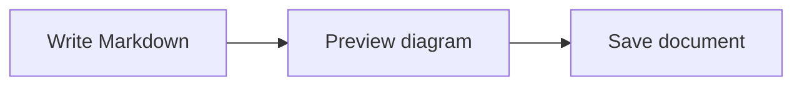
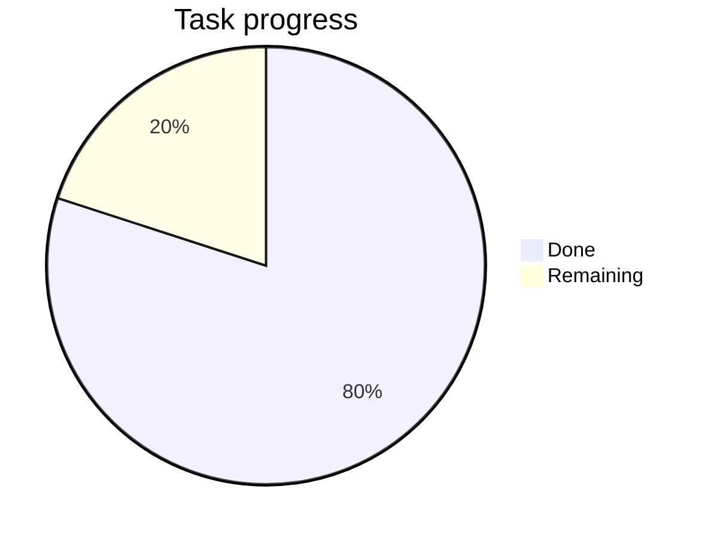

# Markdown Editor

A toolbar-only, two-pane Markdown editor built with **ASP.NET Core MVC 10**, **TypeScript**, and **BEM CSS**. Write Markdown on the left and see a sanitized, rendered preview on the right. The compact toolbar and link dialog follow the supplied Word reference, without File, Edit, or View menus.

## Branch workflow

Create feature branches from the latest development branch:

```powershell
git fetch origin
git switch --no-track -c feature/your-feature origin/development
```

Open feature pull requests against `development`. Update the feature branch from `development` before merging. Promote releases through a `development` to `main` pull request; release history can be synchronized back through a `main` to `development` pull request.

`development` is the default GitHub branch. Both long-lived branches block deletion and force pushes and require pull requests with the GitHub Actions `branch-policy` status. Only this repository's `development` branch may merge into `main`; its existing `validate` build check is also required. The [branch policy workflow](.github/workflows/branch-policy.yml) checks PR routing and that feature PRs include the current development base. Git does not record the original branch-creation point, so the default branch, creation command, and repository guidance establish that convention; the status check enforces ancestry at merge time.

## Run locally

Install a .NET SDK that supports .NET 10 and Node.js 22 or newer. From the repository root:

```powershell
npm.cmd --prefix MarkdownEditor.Web ci
dotnet build MarkdownEditor.slnx
dotnet run --project MarkdownEditor.Web
```

Open **http://localhost:5100**. On macOS/Linux, use `npm` instead of `npm.cmd`. `dotnet build` and `dotnet run` rebuild frontend assets automatically; restore npm dependencies first. `npm --prefix MarkdownEditor.Web run build` performs a standalone TypeScript check and frontend build.

Open `MarkdownEditor.slnx` in a current Visual Studio or Rider version for solution-based development.

## Azure deployment

The application is configured for the `markdown-editor` Azure Web App. The deployment workflow in [`.github/workflows/deploy-azure.yml`](.github/workflows/deploy-azure.yml) builds the .NET 10 application and frontend assets, then deploys on every push to `main`. With `main` protected so that changes require an approved pull request, a successful merge automatically deploys the merged commit.

Configure the GitHub Actions secrets `AZURE_CLIENT_ID`, `AZURE_TENANT_ID`, and `AZURE_SUBSCRIPTION_ID` for Azure OpenID Connect authentication. The Azure identity should have the Website Contributor role scoped to the Web App. Pull requests targeting `main` run the validation workflow in [`.github/workflows/validate.yml`](.github/workflows/validate.yml).

## Project layout

For a detailed walkthrough of the server, editor modules, rendering, tables, persistence, security, build pipeline, and tests, see the [architectural design document](Documentation/architecture.md). It includes diagrams and links to the implementation.

```text
MarkdownEditor.slnx
Documentation/architecture.md  Detailed architecture and code guide
Documentation/viewer-sample.md Debug viewer sample document
MarkdownEditor.Web/
  MarkdownEditor.Web.csproj
  package.json               Frontend dependencies and npm scripts
  package-lock.json          Locked frontend dependencies
  tsconfig.json              TypeScript configuration
  build.mjs                  Frontend asset build
  node_modules/              Installed npm packages (ignored by Git)
  Controllers/               Editor, viewer, and submission endpoints
  Views/Editor/Index.cshtml   Host page with CSS/JS references
  Views/Editor/Viewer.cshtml  Read-only viewer host page
  Views/Shared/_MarkdownEditor.cshtml  Reusable editor partial
  Views/Shared/_MarkdownViewer.cshtml  Reusable reader partial (string model)
  Scripts/                   Editor/viewer entry points and editor coordinator
    pane-resizer.ts          Pointer and keyboard control of the pane divider
    editing/                 Formatting, history, image dialog, code insertion
    tables/                  Table parsing, operations, picker, and dialog
    rendering/               Preview, Mermaid diagrams, highlighting, and content extraction
    persistence/             Browser drafts and server submission
    tests/                   Playwright browser scenarios
  wwwroot/css/               BEM styles
  wwwroot/images/            Local viewer sample image
  wwwroot/js/                Generated editor/viewer bundles and lazy shared chunks
  wwwroot/lib/               Generated local Bootstrap Icons assets
```

The web project's `package.json`, `tsconfig.json`, and `build.mjs` manage frontend dependencies and compile its TypeScript. Generated assets are ignored by Git and rebuilt for .NET builds and publishing.

## Embed in another MVC view

Render the shared partial wherever an editor is needed:

```cshtml
<partial name="_MarkdownEditor" />
```

Load these references once in the host view or its layout, as shown in `Views/Editor/Index.cshtml`:

```cshtml
<link rel="stylesheet" href="~/lib/bootstrap-icons/bootstrap-icons.css" asp-append-version="true" />
<link rel="stylesheet" href="~/css/editor.css" asp-append-version="true" />
<link rel="stylesheet" href="~/css/editor-syntax.css" asp-append-version="true" />
<script type="module" src="~/js/editor.js" asp-append-version="true"></script>
```

The partial supplies the toolbar, panes, file input, and dialogs; the host supplies its surrounding page and resources. Give the containing element a height to control the editor's size. Editor styles are scoped to the component, and the partial generates unique IDs for its labels and dialogs. Each instance maintains its own undo history and controls.

Set `ViewData["MarkdownEditorStorageKey"]` before rendering to choose a stable draft key. Use a distinct key for each editor when rendering multiple instances:

```cshtml
@{
    ViewData["MarkdownEditorStorageKey"] = "article-description-draft";
}
<partial name="_MarkdownEditor" />
```

Server-rendered partials initialize automatically. After dynamically adding partial markup, call the bundle's exported `initializeMarkdownEditors(container)` function. Repeated initialization preserves existing instances.

## Read-only Markdown viewer

Open `/Editor/Viewer?markdown=%23%20Hello` to display formatted Markdown through `EditorController.Viewer`. In **Debug builds**, opening `/Editor/Viewer` without a `markdown` query parameter reads and displays [Documentation/viewer-sample.md](Documentation/viewer-sample.md). The build copies this sample into the output's `Documentation` folder. This behavior uses the build configuration, independently of `ASPNETCORE_ENVIRONMENT`, and is excluded from Release builds. Release builds show an empty state when no Markdown is supplied. An explicit `?markdown=` shows an empty document in either configuration, and supplied text overrides the sample.

This GET action is a host example for short text; applications can load larger or private documents in their own controller and pass the Markdown string directly to the view model.

Embed the reader in any MVC view with a string model:

```cshtml
<partial name="_MarkdownViewer" model="Model.Markdown" />
```

Load these resources once in the host view or layout:

```cshtml
<link rel="stylesheet" href="~/css/editor.css" asp-append-version="true" />
<link rel="stylesheet" href="~/css/viewer.css" asp-append-version="true" />
<script type="module" src="~/js/viewer.js" asp-append-version="true"></script>
```

The partial fills its container's width and height and scrolls internally; give the container a height (for example, `height: 400px`). It displays rendered headings, tables, lists, links, images, and highlighted fenced code without a Markdown source pane, toolbar, or draft persistence. Images inserted by the editor's **Insert image** button render from the same `` syntax and scale to fit the reader. The Debug sample includes a local landscape image for verification without an external image service. Embedded HTML controls are disabled. Markdown is Razor-encoded during transport and rendered through the same Marked, DOMPurify, and Highlight.js pipeline as the editor preview.

Multiple readers can coexist with editors. Server-rendered readers initialize automatically. For dynamically inserted partials, import `initializeMarkdownViewers` from `/js/viewer.js` and call it with the containing element. Repeated initialization preserves existing readers. Browser tests cover rendering, unsafe content, empty documents, multiple readers, and desktop/phone sizing.

## Editing

- Heading levels, bold, italic, strikethrough, lists, tasks, quotes, links, images, code, and dividers.
- **Insert image** (the picture toolbar icon) opens a dialog for an absolute HTTP/HTTPS image URL and an optional image description (alt text). Selected text becomes the suggested description and is replaced by ``; with no selection, the image is inserted at the caret. An omitted description defaults to `Image`. The formatted preview displays the image and scales it to fit the pane. Insertion supports undo/redo and draft recovery; Cancel or Escape preserves the document and selection. Images load directly from their URLs; the editor does not upload image files.
- The **Code block** dropdown inserts a fenced block for one of 30 languages and formats, including Mermaid charts/diagrams, C#, TypeScript, JavaScript, SQL, Python, JSON, PowerShell, and Dockerfile. Existing selected text becomes the code body; otherwise, an editable placeholder is selected. Each insertion supports undo.
- Table toolbar with a 5×5 size picker. Place the source cursor in a table, then choose **Edit table** for **Insert**, **Select**, or **Delete** options. Insert columns left/right or rows above/below the current cell; select or delete the table, current column, or current row.
- **Edit cell contents** opens a visual grid. Select actions highlight the requested region in this grid. Edit cell Markdown or change structure, then save as one undoable change; Cancel discards changes. Row counts include the required Markdown header. Deleting a header promotes the next row; deleting the final row or column removes the table.
- Undo/redo, `.md` file import (up to 1 MB), and UTF-8 Markdown download.
- `Ctrl+B`, `Ctrl+I`, `Ctrl+K`, `Ctrl+Z`, `Ctrl+Shift+Z`/`Ctrl+Y`, and `Ctrl+S`; Command shortcuts also work on macOS.
- Draft recovery in this browser's local storage. Saving status reports unavailable storage; download files for a durable copy. Undo history is limited to 200 states and resets on reload.
- Desktop panes start at equal widths with independent scrolling. Drag the vertical divider left/right with a mouse or touch to resize them; each pane keeps at least 25% of the available pane width. Focus the divider and use Left/Right arrows for 5-percentage-point adjustments or Home/End for the limits. Double-click the divider to restore equal widths. Each editor keeps its own split until the page reloads. At phone widths (560px or less), panes stack and the divider is hidden; widening the window restores the previous split.

Markdown is rendered with Marked and sanitized with DOMPurify. Drafts and imported files stay in the browser until **Send to server** is clicked. Referenced external images may still load from their specified URLs. Bootstrap Icons, Axios, the renderer, and the sanitizer are bundled locally, with no runtime CDN requirement.

The preview follows NovarisAI's light-mode palette and typography. As in that project, fenced code keeps a dark background with pink/blue/green/gold syntax highlighting; inline code uses a light bordered surface. Highlight.js is bundled locally with its common languages plus PowerShell, Dart, and Dockerfile. Programming-language dropdown options support highlighting; Mermaid renders as a chart or diagram. Fences can specify a language such as `csharp`, `typescript`, `json`, or `powershell`; unlabelled blocks use automatic detection, while unknown languages remain readable plain text.

## Charts and diagrams

Use a fenced `mermaid` block to render flowcharts, sequence diagrams, pie charts, and other Mermaid diagram types in both the live preview and the read-only viewer:

````markdown



````

Choose **Mermaid chart / diagram** in the **Code block** dropdown to wrap selected text or insert a fence, then replace the selected placeholder with a definition. The locally bundled renderer loads when a document first needs it, and live edits render after a short pause. Keep the generated `wwwroot/js/chunks/` directory alongside the entry bundles when hosting them. No diagram source is sent to an external rendering service.

Diagrams scale to their pane. Invalid definitions remain visible as source with an error message, while other diagrams continue rendering. Each definition is limited to 50,000 characters and 500 edges. Strict security settings disable diagram click actions and HTML labels; sanitized SVG is displayed as an isolated image. Diagram-specific overrides cannot relax these application settings. Source Markdown remains available for accessible text descriptions and editing.

Markdown downloads and drafts retain the original fences. The synchronous content/submission API preserves Mermaid source in plain text and sanitized fenced code in HTML; exported HTML does not include the asynchronously generated diagram images. To display those fences as diagrams, pass the Markdown through the editor or viewer renderer.

## Submit content to a controller

Click **Send to server** (the cloud-upload toolbar icon) to post JSON with Axios to `EditorController.Submit` at `/Editor/Submit`:

```json
{
  "markdown": "# Hello\n\nSome **bold** text.",
  "plainText": "Hello\n\nSome bold text.",
  "html": "<h1>Hello</h1>\n<p>Some <strong>bold</strong> text.</p>\n"
}
```

All three strings are generated from the same Markdown snapshot. Plain text preserves paragraph breaks, code whitespace, image descriptions, and tab-separated table columns. HTML includes sanitized markup and syntax-highlighting spans; use the preview CSS when displaying it.

The action binds JSON to `Models/MarkdownSubmission.cs`, validates the request and anti-forgery token, and returns `{ "message": "Document received.", "document": { ... } }`. Add your persistence logic in this action; the example acknowledges receipt without saving to a database. Client-supplied HTML remains untrusted on the server: sanitize or regenerate it before later rendering it.

Set `ViewData["MarkdownEditorPostUrl"] = Url.Action("YourAction", "YourController")` before rendering the partial to target another same-origin action. That action should accept the same model and validate the `X-CSRF-TOKEN` header. The partial supplies the token automatically. The endpoint accepts empty documents, limits Markdown/plain text to 1,048,576 characters each and HTML to 4,194,304 characters, and caps request bodies at 8 MiB.

Host scripts can also use the bundle's API:

```javascript
import { getEditorContent, submitEditorContent } from '/js/editor.js';

const editor = document.querySelector('[data-markdown-editor]');
const content = getEditorContent(editor); // { markdown, plainText, html }
const receipt = await submitEditorContent(editor);
```

Toolbar submissions dispatch a bubbling `markdown-editor:submitted` event on their editor root with the controller response in `event.detail`. Duplicate clicks are blocked while a request is pending; request failures appear in the footer and leave the document intact.

## Markdown source colors

Fenced code blocks have a continuous, full-width tinted background covering the opening fence, code lines, and closing fence. Inline code keeps its compact text background. Both use `--syntax-code-background` in `editor-syntax.css`.

The editable source pane highlights headings, bold text, italics, strikethrough, links, quotes, list markers, inline code, and fenced code blocks while keeping Markdown characters visible. Native selection, keyboard shortcuts, undo, and draft persistence remain available. The decorative highlighting layer is hidden from assistive technology; forced-color mode uses the native text colors.

Customize source colors in `MarkdownEditor.Web/wwwroot/css/editor-syntax.css`. Its `.editor` variables include `--syntax-heading`, `--syntax-bold`, `--syntax-italic`, `--syntax-strikethrough`, `--syntax-link`, `--syntax-code`, and `--syntax-code-background`. Override these variables on a host editor to theme individual instances. Keep the mirror and textarea font metrics synchronized when changing typography. These settings affect the source pane; preview styles remain in `editor.css`.

## Verify

```powershell
cd MarkdownEditor.Web
npx.cmd playwright install chromium
npm.cmd test
```

Tests start the MVC app automatically and cover live rendering, Mermaid charts and diagrams, pane resizing by mouse/touch/keyboard, draft recovery, formatting, history, links, image insertion and loading, unsafe HTML, import/export, reusable readers, the Debug viewer sample, and responsive layout. The default test server uses a Debug build; when reusing an existing server, ensure it serves the current Debug build. Desktop and phone screenshots are saved under `MarkdownEditor.Web/test-results/`. There is no numeric coverage threshold.
